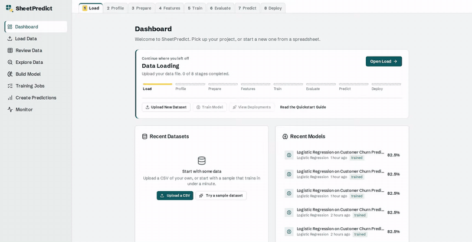
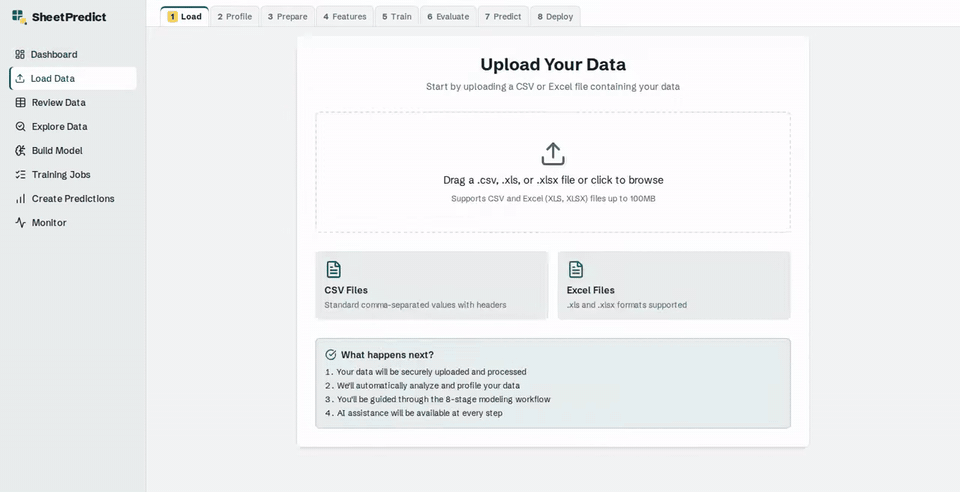
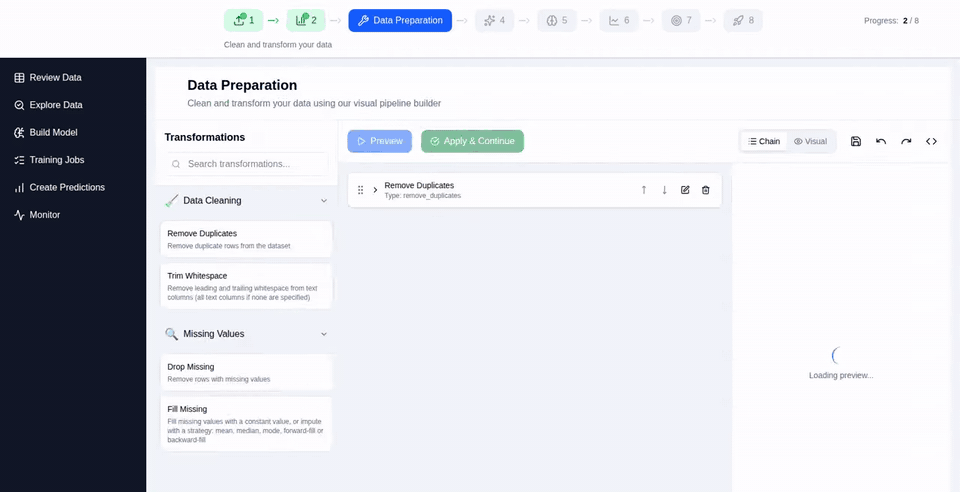
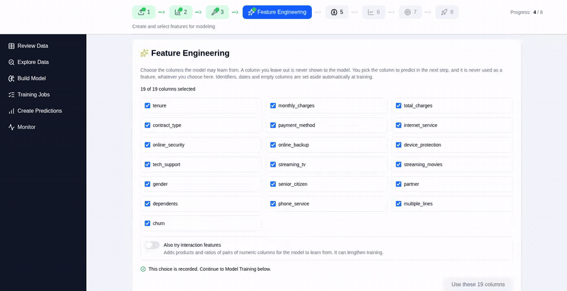
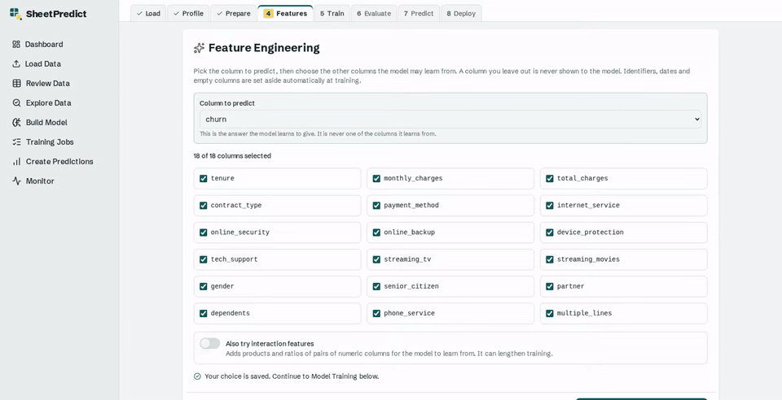
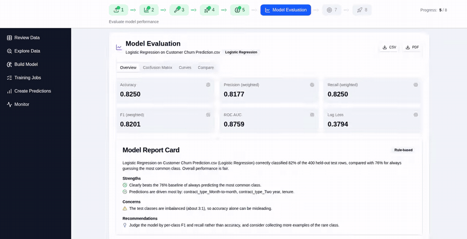
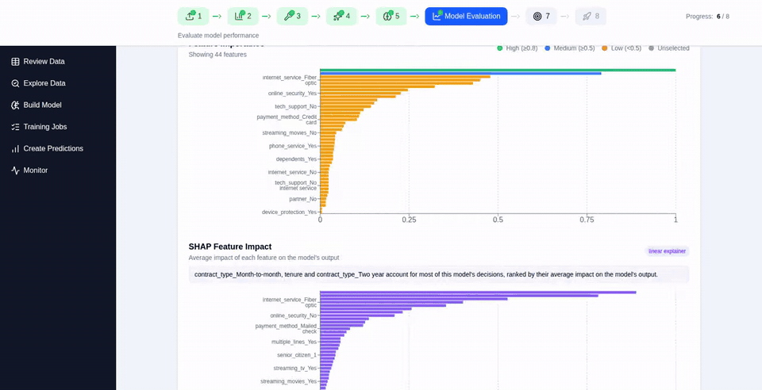
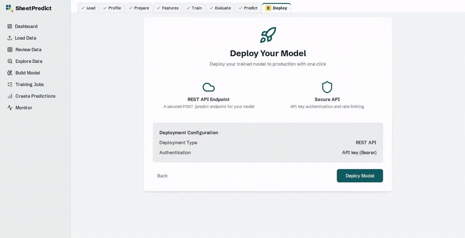
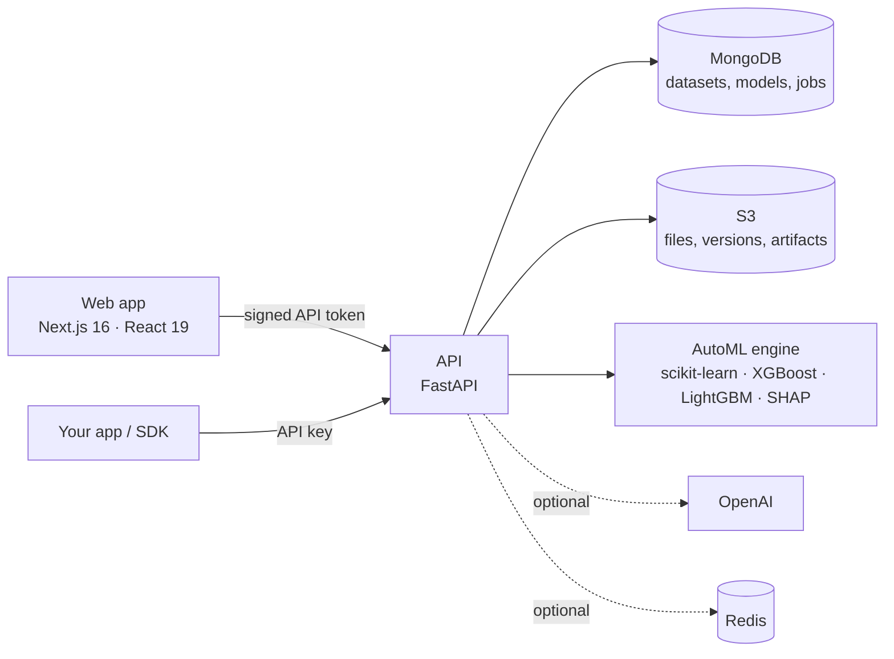

<div align="center">


<br><br>

**Turn a spreadsheet into a validated, explained, deployable model in minutes, and see how it got there.**

Upload a CSV or Excel file. SheetPredict profiles it, helps you clean it, trains and cross-validates
several algorithms, explains the winner, and serves it from a secured prediction endpoint.
You write no code.

<a href="#run-it-yourself"><b>Run it yourself →</b></a>
&nbsp;·&nbsp;
<a href="#from-spreadsheet-to-endpoint">How it works</a>
&nbsp;·&nbsp;
<a href="#documentation">Documentation</a>
&nbsp;·&nbsp;
<a href="#contributing">Contributing</a>

<br>

[](https://github.com/frankbria/narrative-modeling-app/actions/workflows/ci.yml)
[](LICENSE)


<br>



</div>

---

## Built for people who have to defend the number

You have a flat table of data and a question: who will churn, which students need support, what a house
will sell for. You also have someone who will ask *"why this model, and what drives it?"* Maybe that's a
reviewer, a committee, a PI or a stakeholder.

SheetPredict is for applied researchers and analysts who aren't ML engineers. It takes you from a raw
spreadsheet to a model you can explain, reproduce and put to work. A guided workflow keeps you on solid
ground at every step.

| | |
| --- | --- |
| ✅ **Validated, not vibes** | Algorithms are cross-validated against each other and against a baseline, with a plain-language note on why the winner won. |
| 🔍 **Explained** | SHAP explanations for each model you train, and a model report that states only what was actually recorded. |
| 🔁 **Reproducible** | A full version history for your data, undo and redo, and every preparation step exportable as Python. |
| 📦 **Yours to keep** | Export a trained model as self-contained Python or a Docker bundle, or call it from a secured REST endpoint. |
| 🛡️ **Safe with real data** | PII is scanned on in-app uploads, the whole workflow runs without an AI key, and one click erases your data. |
| 🔓 **Open source** | Apache 2.0. Read every line, run it on your own machine, and change it as you like. |

---

## From spreadsheet to endpoint

Eight guided stages, each unlocked when the one before is done. Every animation below is the real app,
recorded on the bundled customer-churn sample.

### 1 · Load and profile your data

Drop in a CSV or Excel file of up to 100 MB (large files upload in chunks), or start from a sample dataset
in one click. SheetPredict reads every column, infers its type, and gives you statistics, charts,
data-quality scores and an AI summary of what's in the file.



### 2 · Prepare it, step by step

Build a cleaning pipeline visually: remove duplicates, trim whitespace, drop or fill missing values (mean,
median, mode, forward or backward fill). Preview the effect before you apply it, undo and redo freely,
and keep every version. When you're done, export the whole pipeline as a Python script, or save it as a
recipe and run it on the next file.



### 3 · Choose your features

Pick the columns the model may learn from. Identifiers, dates and empty columns are detected and set
aside for you, so an ID column can't quietly leak the answer. If you want, switch on interaction
features and let the model try combinations of columns.



### 4 · Train with AutoML

Choose a target column and SheetPredict works out whether it's a classification or regression problem.
**Quick** mode trains a handful of fast, strong algorithms in a minute or so. **Comprehensive** mode runs
the full catalogue (gradient boosting, XGBoost, LightGBM, random forests, linear models, SVM and
nearest neighbours) with hyperparameter tuning. You get a leaderboard with
cross-validated and hold-out scores, plus a written explanation of the choice.



### 5 · Evaluate and explain

See how the model really performs: accuracy, precision, recall, F1, ROC AUC and a confusion matrix for
classifiers, and error metrics for regression, all compared against a baseline. A model report card
spells out strengths, cautions and next steps. Feature importance and SHAP impact show what drives the
predictions, in a form you can put in front of a reviewer.



### 6 · Predict

Score a single record from a form, or upload a CSV for batch predictions. Each result comes with its
confidence and the factors behind it. Inputs the model has never seen, or that are missing, are flagged
rather than silently guessed.



### 7 · Deploy

Put the model behind a REST endpoint secured with API keys and rate limits. Then generate a client SDK
and watch for drift as new data arrives. Prefer to run it yourself? Download the model as self-contained
Python or a Docker bundle; neither needs SheetPredict to run.



---

## Built to be trusted

- **Your file is never sent whole to an AI provider.** AI features see a statistical profile of your
  data and at most five sample rows. The in-app upload scans for personal information and asks before storing a
  high-risk file; you can keep a masked copy instead.
- **No AI key? Still works.** Summaries, guidance and analysis fall back to rule-based answers, so the
  whole workflow runs without an OpenAI key; only the chat assistant needs one. With a key, calls run
  behind a circuit breaker, per-account quotas and a daily ceiling.
- **Erasure that means it.** Delete one dataset or everything in your account. Its files, versions,
  models and jobs go with it.
- **Tamper-evident models.** Trained model artifacts are signed, and checked before they're loaded.
- **Open source.** Apache 2.0, so you can audit it, self-host it and change it.

### What it doesn't do yet

SheetPredict works on one flat CSV or Excel file of up to 100 MB. It has no database or cloud-storage
connectors and doesn't join multiple files. If your data lives only in a warehouse, it isn't the right
tool yet.

---

## Run it yourself

You need **Docker**, **Python 3.13** with [uv](https://docs.astral.sh/uv/), and **Node** `^22.13.0 || >=24`.

```bash
# MongoDB on :27017 and LocalStack S3 on :4566, with the dev bucket created
./scripts/local-setup.sh

# Backend on :8000
cd apps/backend
cp .env.example .env          # then apply the Mongo overrides in docs/dev/LOCAL_DEVELOPMENT.md
uv sync
uv run uvicorn app.main:app --reload --host 127.0.0.1 --port 8000

# Frontend on :3000 (in a second shell)
cd apps/frontend
cp .env.local.example .env.local   # NEXTAUTH_SECRET must equal the backend's
npm install
npm run dev
```

Open <http://localhost:3000> and pick a sample dataset to see the whole workflow in a few minutes.
The API's interactive docs are at <http://localhost:8000/docs>.

> [!NOTE]
> `apps/backend/.env.example` sets `SKIP_AUTH=true`, which maps every request to a single dev user. The
> backend refuses to start with it unless `ENVIRONMENT` is `development` or `test`.
> [LOCAL_DEVELOPMENT.md](docs/dev/LOCAL_DEVELOPMENT.md) covers the full setup, including real
> Google or GitHub sign-in.

**Optional services.** You don't need any of these to try it:
- **OpenAI** powers the AI summaries and guidance; without a key, the rule-based fallbacks answer.
- **Redis** shares the cache and rate limits across workers.
- **Stripe** turns on billing; without keys, every account runs on the free tier.

### How it fits together



| Layer | Built with |
| --- | --- |
| **Web** | Next.js 16, React 19, TypeScript, Tailwind CSS 4, NextAuth v5 (Google and GitHub) |
| **API** | Python 3.13, FastAPI, Pydantic, Beanie on MongoDB |
| **ML** | pandas, scikit-learn, XGBoost, LightGBM, Optuna, SHAP |
| **Storage** | MongoDB, S3 (LocalStack locally), Redis (optional) |
| **Quality** | pytest, Jest, Playwright on the real stack, ruff, mypy, ESLint, and a complexity-and-coverage gate on every change |

---

## Testing

```bash
# Backend: the pull-request gate (needs MongoDB on :27017)
cd apps/backend && PYTHONPATH=. uv run pytest tests/ -m "not integration and not performance"

# Frontend: unit tests, types and lint
cd apps/frontend && npm test && npm run type-check && npm run lint

# End to end, against the real backend and frontend
cd apps/frontend && npm run test:e2e:smoke
```

Every pull request runs all of these in [`ci.yml`](.github/workflows/ci.yml), and the full end-to-end suite
runs nightly.

---

## Documentation

| Guide | What's in it |
| --- | --- |
| [Local development](docs/dev/LOCAL_DEVELOPMENT.md) | Running from source, environment variables, real sign-in locally |
| [Test infrastructure](docs/dev/TEST_INFRASTRUCTURE.md) | The backend suites, markers, services and what CI requires |
| [E2E testing](docs/dev/E2E_TESTING_GUIDE.md) | Playwright on the real stack, test users, and re-recording the demo media |
| [Staging deployment](docs/ops/STAGING_DEPLOYMENT_GUIDE.md) | How `main` ships to staging with Docker Compose behind nginx |
| [Credential rotation](docs/ops/CREDENTIAL_ROTATION.md) | Every secret, where it lives and how to rotate it |
| [Data erasure and backup](docs/ops/DATA_ERASURE_AND_BACKUP_RUNBOOK.md) | What erasure removes, and the backup and restore drill |
| [Artifact integrity](docs/ops/ARTIFACT_INTEGRITY.md) | How model artifacts are signed and verified |
| [Architecture decisions](docs/adr/) | Billing, plan limits and pricing |
| [Positioning](docs/product/positioning.md) | Who SheetPredict is for, and what it does and doesn't claim |
| [CLAUDE.md](CLAUDE.md) | Project conventions and the guard tests that enforce them |

---

## Contributing

Contributions are welcome. Fork the repository, work on a feature branch and open a pull request against
`main`. The conventions and the guard tests that enforce them are in [CLAUDE.md](CLAUDE.md), with
app-specific notes in [`apps/backend/CLAUDE.md`](apps/backend/CLAUDE.md) and
[`apps/frontend/CLAUDE.md`](apps/frontend/CLAUDE.md). A green `CI Success` check is required to merge.

If SheetPredict is useful to you, a ⭐ helps other people find it.

## License

Licensed under the [Apache License, Version 2.0](LICENSE). See [NOTICE](NOTICE) for attribution.

Copyright © 2025-2026 Noatak Enterprises, LLC, dba Bria Strategy Group

## Author

**Frank Bria** · [frankbria.com](https://frankbria.com) · [@FrankBria18044](https://x.com/FrankBria18044)
